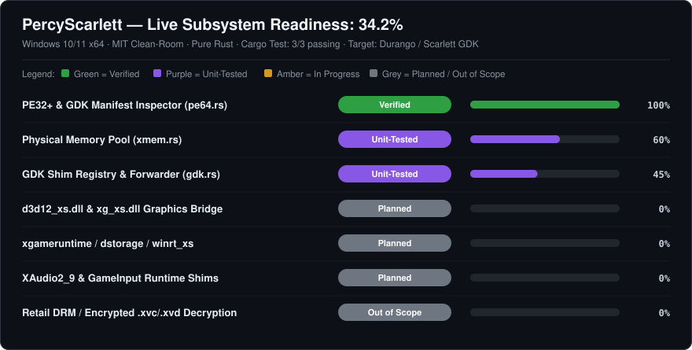

# PercyScarlett

**Clean-room Rust translation layer, GDK shim suite, and PE32+ inspection toolkit for running unencrypted Xbox Series X|S (Scarlett) executables natively on Windows x64 — built specifically for Codename G6.**

Pure Rust · Zero third-party emulator code · Zero proprietary SDK headers · `0 GB` duplicate disk overhead.

---

## Live Status & Surface Coverage




---

## Why PercyScarlett

| Capability | PercyScarlett | Offline Recompilers |
| :--- | :--- | :--- |
| **Disk Overhead** | **0 GB** (NTFS junctions + hardlinks) | ~350 GB extracted intermediates |
| **CPU Execution** | **Native x86-64** (`machine=0x8664`) | Native / static recompile |
| **Shipped Sidecar DLLs** | **6/6 live-loaded on Win11 (`LoadLibraryW`)** | Untested |
| **Compiled Shim DLLs** | **8 Rust `cdylib` DLLs** (`12/12` tests passing) | Skeleton / Incomplete |
| **Day-1 Crash Telemetry** | **Built-in VEH fault logger** + `PERCY_XMEM_LOG` | External debugger required |
| **Xbox VFS & Auto-Stubs** | **`G:/T:/S:` rewrite** + `percyscarlett stubgen` | Manual |

---

## Verified Proof Against Codename G6

> Full binary breakdown & IAT routing: **[docs/CODENAME_G6_PROOF.md](docs/CODENAME_G6_PROOF.md)**

1. **6/6 Shipped Xbox Sidecar DLLs Load Live on Windows 11 (`percyscarlett verify-dlls`)**
   ```text
   [PASS] amd_fidelityfx_loader_xbox.dll loaded at 0x7ffc14430000
   [PASS] amd_fidelityfx_upscaler_xbox.dll loaded at 0x7ffbfb310000
   [PASS] Bink2Scarlett.dll loaded at 0x7ffc143f0000
   [PASS] libHttpClient.GDK.dll loaded at 0x7ffb95710000
   [PASS] XboxBvhBuilder.dll loaded at 0x7ffbfb300000
   [PASS] XCurl.dll loaded at 0x7ffc14410000
   DLL verification: 6 passed, 0 failed
   ```
2. **End-to-End PE32+ Guest Execution (`tests/e2e_bringup.rs`)**
   Compiles and executes a real PE32+ binary (`scarlett_guest.exe`) dynamically linked against all 8 shim DLLs, validating `XMemAlloc*`, `D3D12CreateDevice` / `D3D12SerializeRootSignature` (Scarlett flag masking), `HSTRING`, `XTaskQueue` / `XUser`, `DStorageGetFactory`, `GameInputCreate`, `kernelx`, `xg_xs`, `inspect`, and `stubgen`.
3. **Physical Memory Pool (`percyscarlett probe-mem`)**
   ```text
   Allocated 16 MiB Scarlett physical test block at 0x1eb59000000 (active=16777216 B, blocks=1)
   ```

---

## Workspace Crates

| Crate | Output | Implemented Surface |
| :--- | :--- | :--- |
| Root (`src/`) | `percyscarlett.exe` | PE32+ parser, `inspect`, `plan`, `verify-dlls`, `stubgen`, `probe-mem`, `shims` |
| `crates/xmem` | `xmem.dll` | `XMemAlloc*`, `XMemFree*`, `XMemVirtualQuery`, working set stats, VEH crash logger |
| `crates/kernelx` | `kernelx.dll` | `XMemAlloc*`, `TitleMemoryStatus`, `JobTitleMemoryStatus`, `SetThreadName` |
| `crates/d3d12_xs` | `d3d12_xs.dll` | `D3D12XboxCreateDevice`, `D3D12CreateDevice`, root sig flag masking, deserializer, debug |
| `crates/xg_xs` | `xg_xs.dll` | `XGGetFormatBlockInfo`, `XGCreateTexture2DComputer` COM vtable |
| `crates/xgameruntime` | `xgameruntime.dll` | `XTaskQueue*`, `XAsync*`, `XUser*`, `Xbl*` offline auth, `XGameSaveInitializeProvider` |
| `crates/dstorage` | `dstorage.dll` | `DStorageGetFactory` (`IDStorageFactoryX` / `QueueX` / `FileX`), `G:/T:/S:` VFS rewrite |
| `crates/winrt_xs` | `winrt_xs.dll` | `RoInitialize`, `RoUninitialize`, `RoGetActivationFactory`, `Windows*String` (`HSTRING`) |
| `crates/gameinput` | `GameInput.dll` | `GameInputCreate` |

*(Extended console audio/OS recognition for `chad.dll`, `xapu.dll`, `AcpHal.dll`, and `xcrdapi.dll` is built into `src/gdk.rs` + `stubgen`.)*

---

## Quick Start (Windows 10/11 x64)

### Build
```powershell
git clone https://github.com/rpatty-dev/PercyScarlett.git
cd PercyScarlett
cargo build --release --workspace
```
*(If using `x86_64-pc-windows-gnu`, ensure `mingw64\bin` is on `PATH`.)*

### Day-1 Bring-Up
```powershell
# 1. Inspect executable imports & auto-generate any missing shim stubs
.\target\release\percyscarlett.exe inspect "C:\path\to\game.exe"
.\target\release\percyscarlett.exe stubgen "C:\path\to\game.exe" ".\generated_stubs"

# 2. Verify all build DLLs against staged target\release\*.dll
.\target\release\percyscarlett.exe plan "C:\path\to\build_dir"
.\target\release\percyscarlett.exe verify-dlls "C:\path\to\build_dir"
```

### Non-Destructive Overlay Mount
1. Create a mount directory (e.g. `D:\PercyScarlett_Mount`).
2. Junction (`mklink /J`) large asset subdirectories and hardlink (`mklink /H`) root files.
3. Copy `target\release\*.dll` into the mount directory, optionally set `PERCY_VFS_G`, `PERCY_XMEM_LOG`, and `PERCY_CRASH_LOG`, and launch.

---

## Tests (`12/12 passing`)

```powershell
cargo test --workspace
```

- `e2e_bringup` (1): Synthetic PE32+ `scarlett_guest.exe` build, `inspect`, `stubgen`, and live execution across all 8 shim DLLs
- `percyscarlett` (3): PE32+ parser, Win32 `VirtualAlloc` pool, live `kernel32.dll` forwarding
- `xmem` (1), `kernelx` (1), `d3d12_xs` (1), `xg_xs` (1), `xgameruntime` (1), `dstorage` (1), `winrt_xs` (1), `GameInput` (1): C-ABI exports, COM vtables, `HSTRING`, VFS rewrite, and host D3D12 forwarding

---

## Legal Notice

PercyScarlett is an independent, clean-room interoperability research project licensed under the [MIT License](LICENSE).
It contains no proprietary Xbox/Microsoft SDK headers, keys, or binaries, and does **not** decrypt, bypass, or strip retail DRM or encrypted `.xvc`/`.xvd` packages. Users must supply their own lawfully obtained, unencrypted executables.
