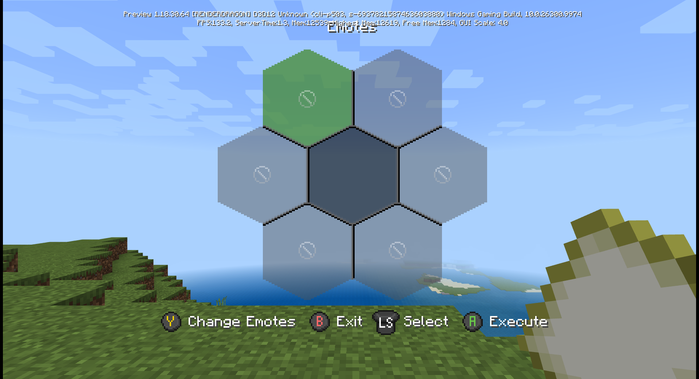
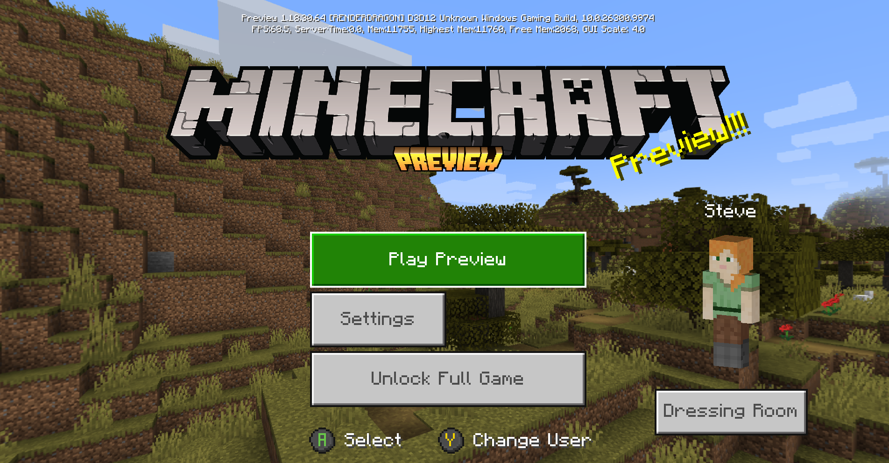
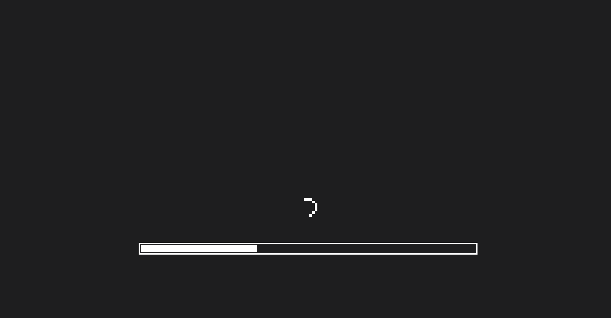

<p align="center">
  
</p>

<h1 align="center">PercyScarlett</h1>

<p align="center">
  <a href="https://rpatty-dev.github.io/PercyScarlett/"><strong>Project site</strong></a> ·
  <a href="docs/TheBig6.md"><strong>TheBig6 😉 readiness</strong></a> ·
  <a href="CHANGELOG.md"><strong>Changelog</strong></a> ·
  <a href="https://github.com/sponsors/rpatty-dev"><strong>♥ Sponsor</strong></a>
</p>

Clean-room Rust translation layer that runs unencrypted Xbox Series X|S (Scarlett) GDK titles natively on Windows 10/11 x64. The title's x86-64 code runs as-is; PercyScarlett maps it in-process and supplies the console-only pieces: D3D12.X, XMem, the Xbox runtime, input, audio hardware, storage and networking.

**v0.9: a retail Scarlett title reaches the main menu and plays in-world, and the pipeline is ready for TheBig6 😉.**

---

## Proof: Minecraft (Xbox Series X|S build) on Windows



| Main menu | Loading |
| :---: | :---: |
|  |  |

- Unmodified Scarlett exe, offline local player, world created, saved and reloaded.
- Main menu renders at several hundred FPS. In-world is ~45-50 FPS on an RTX 2060 SUPER before the v0.9 VRAM mirror (verification of the mirror is in progress).
- Known issue: about half of launches still hit an intermittent heap corruption during asset loading. Relaunch if it closes during the loading screen.

---

## Ready for TheBig6 😉

Add the package folder to the **Library** before the executable is there. PercyScarlett reads `MicrosoftGame.Config`, builds and registers the identity overlay (missing store art is generated), and sets up a save folder. When the exe arrives: **Check → Launch**.

- All shipped sidecar DLLs (Bink2Scarlett, XboxBvhBuilder, FidelityFX Xbox, libHttpClient.GDK, XCurl) resolve against Windows or PercyScarlett shims, down to every imported function.
- Details: [docs/TheBig6.md](docs/TheBig6.md).

---

## Using it

1. Download the latest release zip and run `percyscarlett.exe`.
2. **Library → Add game folder…** and pick the folder that holds `MicrosoftGame.Config`.
3. **Check** confirms the exe is a plain PE (not encrypted) and lists any import that still needs a shim.
4. **Register** creates the identity overlay and registers it with the PC Gaming Runtime (GDK `wdapp`; Developer Mode required).
5. **Launch**. Per-game options (VRAM mirror, audio, offline sign-in token, D3D12 debug layer, save folder) sit next to the run log.

Command line equivalents: `percyscarlett register <exe>`, `percyscarlett launch <exe>`, `percyscarlett inspect <exe>`.

PercyScarlett never decrypts, patches or bypasses licensing. Use decrypted dumps of games you own.

---

## What's inside

| Crate | Provides |
| :--- | :--- |
| `src/pe_loader.rs` | In-process PE32+ loader: relocations, `.pdata`, guest static TLS, IAT routing, file-system virtualization (`G:`/`T:`/user paths), crash logging with true unwinding |
| `crates/d3d12_xs` | D3D12.X device/list/queue proxy, inline command-record replay, console presents into a DXGI swap chain, UMA buffer VRAM mirror, RDNA2 → DXIL shader lifter |
| `crates/xgameruntime` | Runtime shim over the PC Gaming Runtime: offline XUser, persistent local storage, XGameSave, device association, networking hints |
| `crates/xcurl` | Offline XCurl (loopback transfers, empty Xbox Live replies) |
| `crates/acphal`, `crates/xapu` | Audio control processor and APU memory for console audio middleware |
| `crates/gameinput` | GameInput with a scriptable virtual gamepad |
| `crates/xmem`, `crates/kernelx` | XMem pools and console kernel extras |
| `crates/dstorage`, `crates/xg_xs`, `crates/xaudio2_9`, `crates/winrt_xs` | DirectStorage, XG texture layouts, XAudio2, WinRT surface |

Self-test (no game needed): download [`Run_SelfTest_And_Report.bat`](https://github.com/rpatty-dev/PercyScarlett/releases/latest/download/Run_SelfTest_And_Report.bat), or in the app **Settings → Run Self-Test**. It opens a pre-filled GitHub issue with your results.

---

## Build

```
cargo build --release --workspace
cargo test --workspace --release
```

Rust stable (x86_64-pc-windows-gnu), Windows 10/11 x64, Microsoft GDK for `wdapp`. `dxcompiler.dll` / `dxil.dll` ship in the release zip.

---

## Credits & licence

- XCurl offline transfer logic ported from [OpenScarlett](https://github.com/californiaAlmonds/OpenScarlett) (MIT, © 2026 OpenScarlett Contributors).
- AMD RDNA2 ISA opcode table from AMD's MIT-licensed machine-readable ISA.
- PercyPRO font under the SIL OFL (`assets/fonts/OFL.txt`).

PercyScarlett is released under the licence in [LICENSE](LICENSE). Not affiliated with Microsoft, Xbox, Mojang or any publisher.
